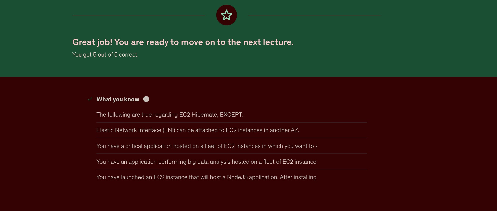
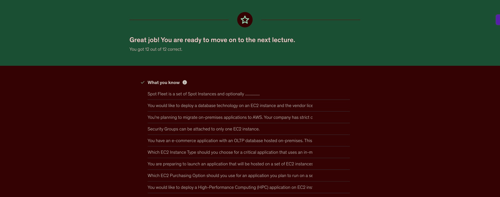

# Module 1, Lab 0.5: Basics Continued

**Student:** Ben Tucker (Bruceleeroy83)
**Due:** Monday, October 26, 2026 (class doc) · Lab README: Tuesday, October 27, 12:00 PM Central

## Group (required)

See [group_BenTucker.txt](group_BenTucker.txt).

| | |
|---|---|
| Spotter | Richie Bias |
| Teammates | Ben Tucker, Richie Bias, Kenneth Phillips, Dwayne Simone |
| Meeting days + times | Mondays & Wednesdays, 7:00–8:30 PM CT |

## Reading

| Source | Assignment | Done? |
|---|---|---|
| Bahga, *Blue Book* | Pages 25–53 and 69–80 |  |
| SAA Exam Guide | Chapters 1 and 4 |  |
| AWS Developer | Chapters 2 and 5 |  |

<!-- One or two things you learned from the reading. -->

## Videos

| Video | Done? |
|---|---|
| Maarek Udemy, Section 3 (no quiz) | |
| Maarek Udemy, Section 5 + quiz | ✅ 12/12 |
| Maarek Udemy, Section 6 + quiz | ✅ 5/5 |
| YouTube: EC2 Instance Types | |
| YouTube: Git Bash, Bash Basics | |
| YouTube: Git Tutorial for Beginners | |

### Quiz screenshots

## Extra credit (BAM)

| Item | Requirement | Screenshot | Done? |
|---|---|---|---|
| BAM_1.1 | Local SSH client; `whoami` + `date` visible | `screenshots/BAM_1.1.jpg` | No |
| BAM_1.2 | Custom page: thank-you line, dollar line, picture | `screenshots/BAM_1.2.jpg` | No |
| BAM_1.3 | Local SSH; `user_data` script displayed with `cat` | `screenshots/BAM_1.3.jpg` | No |
