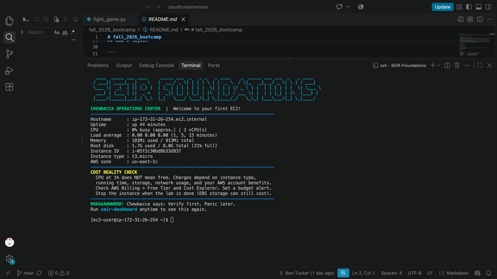
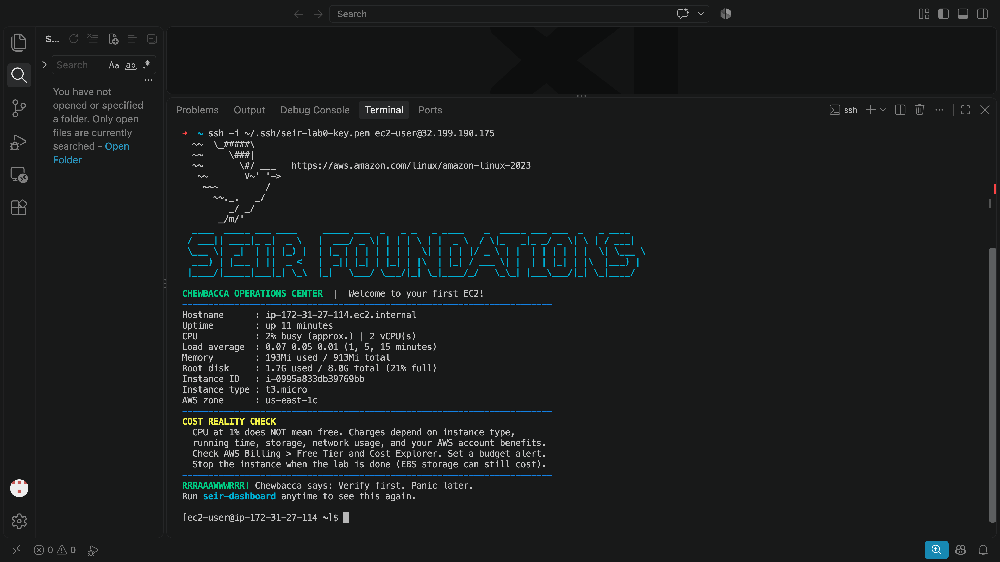
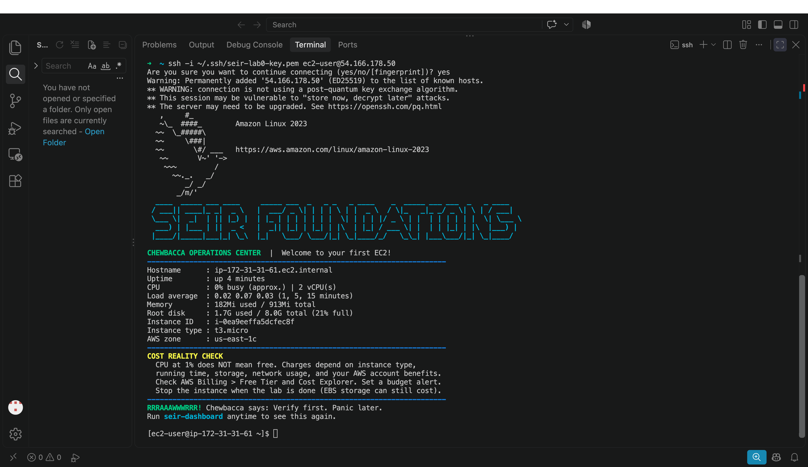

# Module 1, Lab 0: Three EC2 Deployments

**Student:** Ben (Bruceleeroy83)
**Region:** us-east-1 (N. Virginia)
**Launch template:** `seir-foundations-lab0` (Amazon Linux 2023, t3.micro, SEIR User Data script)

## Evidence table

| Deployment | Public IPv4 address | Connection method | Screenshot | Instance terminated? |
|---|---|---|---|---|
| 1 | `98.94.3.116` | SSH (Mac terminal) | [deployment-1.png](screenshots/deployment-1.png) | Yes |
| 2 | `32.199.190.175` | SSH (Mac terminal) | [deployment-2.png](screenshots/deployment-2.png) | Yes |
| 3 | `54.166.178.50` | SSH (Mac terminal) | [deployment-3.png](screenshots/deployment-3.png) | Yes |

## Deployment 1

First I updated my copy of the class repo so I had the lab files and then I signed in to AWS region us-east-1. I created a launch template called seir-foundations-lab0 with Amazon Linux 2023, a t3.micro, my key pair, SSH allowed only from my IP, and the SEIR startup script in User data. After that I launched the instance from the template. I waited for it to pass its status checks, and copied its public IP (98.94.3.116). I connected from my VS Code terminal with the ssh command and typed yes. I checked I was on the server: the prompt said `ec2-user@ip-` instead of `➜  ~`. The dashboard showed on its own, and I took a screenshot (deployment-1.png).  It showed 2 vCPUs, 181Mi of 913Mi memory used, and 44 minutes of uptime. Then I terminated the instance. 

## Deployment 2

For my second deployment I reused my launch template, so everything was all set up for me in deployment 2. All I needed to do was launch the template and make sure it passed. I also checked the IP was new (32.199.190.175). At first I ran `seir-dashboard` on my Mac by mistake and got `command not found`, so I reconnected with SSH and typed yes. I connected with SSH using the new IP, and took a screenshot and logged out. Then I terminated the instance.

## Deployment 3

For my third deployment I followed my own notes and did what I did in Deployments 1 and 2. 
This time AWS gave me new IP: 54.166.178.50 totally different from the first 2 deployments. While connecting, I accidentally typed `yes` at my Mac's `➜  ~` prompt, not as the answer to SSH's question.  On a Mac, yes is a real command that prints y forever, so the screen filled with `y`. I fixed it by pressing `Ctrl+C` to stop it. The dashboard showed up on its own with 0% CPU, 182 Mi of 913 Mi, and 4 minutes of uptime. I took a screenshot deployment-3.png and logged out. When I went to terminate it, I noticed there was an extra instance running and terminated both.

## What the dashboard numbers tell me

| Metric | What I saw | What it tells me |
|---|---|---|
| CPU | 0–2% busy, 2 vCPUs | The server was mostly idle because nothing was running on it except the system itself. 2 vCPUs matches the t3.micro I picked. |
| Memory | about 180–190Mi used of 913Mi | Only about 20% of the memory was used, so there was plenty free. It shows 913Mi instead of 1 GiB because Linux keeps some memory for itself. |
| Disk | 1.7G used of 8.0G (21%) | The operating system and installed programs use about 1.7G. The 8 GiB is the storage size from my launch template. |
| Uptime | 44 min, 11 min, 4 min | Uptime is how long the server has been on since it started. It got shorter each time because I got faster at launching and connecting. AWS charges for the whole time it runs, so terminating quickly matters. |

## What got easier by the third time

After I built the launch template the first time, I didn't have to set anything up again. For deployments 2 and 3 I just launched from the template, copied the new IP, and connected. By the third one I was following my own notes instead of asking for each step, and I connected in about 4 minutes instead of 44.

## Errors I hit and how I fixed them

| Error | Fix |
|---|---|
| `git pull upstream main` said "divergent branches" | Ran `git pull --no-rebase upstream main` to merge the instructor's changes with mine |
| `git push` was rejected because GitHub had a change I didn't have | Ran `git pull --no-rebase origin main` first, then pushed. Lesson: pull before push. |
| Launch template wouldn't save: security group rule had an empty Source | Removed the extra empty rule and set Source to My IP |
| Typed the template name in the terminal: `command not found` | The template name is in the AWS Console, not a terminal command |
| `seir-dashboard: command not found` | I was still on my Mac (`➜  ~` prompt). Reconnected with SSH and typed `yes`. |
| Typed `yes` at my Mac prompt and it printed `y` forever | Pressed `Ctrl+C` to stop it |
| Ran `ssh` from inside the server: `Identity file /home/ec2-user/... not accessible` | Pressed `Ctrl+C`. The key only lives on my Mac, and I was already on the server. |
| An extra instance was running during deployment 3 | Terminated both instances and checked that nothing was left running |

## Cleanup

All three deployment instances, plus the extra one, are terminated. I checked that there are no running instances, no leftover volumes, and no Elastic IPs. My launch template `seir-foundations-lab0` is still saved for Module 1.
