# Module 1, Lesson 1: Balerica Legacy Bank, 7 Deploys

**Student:** Ben Tucker (Bruceleeroy83)
**Assignment:** Deploy the Balerica Legacy Bank (FastAPI + COBOL core) on EC2 **7 times from scratch**, with notes for each deploy.
**Runbook:** [BalericaAI/SEIR-Foundations, module1/lesson1_ec2/API/runbook.md](https://github.com/BalericaAI/SEIR-Foundations/blob/main/module1/lesson1_ec2/API/runbook.md)

## How each deploy goes

1. **Launch** from my launch template in **us-east-1 (N. Virginia)**, instance type **t3.small** (2 GB memory), Name tag `bank-repN-date`
2. **Connect**: EC2 Instance Connect or SSH from my Mac
3. **Build**: `sudo dnf install -y git` → `git clone` the course repo → run `install.sh`
4. **Test the COBOL core**: `account_lookup 100001` (return code 0), `account_lookup 999999` (return code 4), `payment_post` → `POSTED`
5. **Start the API** (Window 1): `source venv/bin/activate` → `uvicorn app.main:app --host 0.0.0.0 --port 8000`
6. **Be the customer** (Window 2): `curl http://127.0.0.1:8000/status` → `python3 swift/traffic_generator.py --count 10` → **FAILED : 0**, CONNECTIVITY CONFIRMED
7. **From outside**: `http://<public DNS>` (port 80) and `http://<public DNS>:8000/docs` → **POST /ask** → Code 200
8. **Terminate** the instance and check that nothing is left running

Security group: SSH 22 (my IP + EC2 Instance Connect prefix list), HTTP 80, Custom TCP 8000 (my IP).

## Deploy log

| # | Date | Time | Instance | Connect | Result | What broke / what I fixed |
|---|---|---|---|---|---|---|
| 0 | 10/27 | ~120 min (class) | t3.micro | Mac SSH | ✅ CONNECTIVITY CONFIRMED, /ask 200, terminated | git wasn't installed on the server, stray backtick (`bquote>`), forgot `cd`, Window 1 closed, JSON body on /ask |
| 1 | 10/28 | 93 min | t3.micro | Mac SSH | ✅ SWIFT 9 posted / 1 rejected / **0 failed**, /ask 200, terminated | Control + C in Window 1 stopped the bank · typed `127.0.0.1` in Chrome (only works inside the server) · ran `ssh` while already inside |
| 2 | 10/28 | 98 min | **t3.small** | **Instance Connect** | ✅ SWIFT 7 / 3 / **0 failed**, port 80 + 8000 from outside, /ask 200, terminated | Added the Instance Connect prefix list to my SG · first launch was t3.micro with no name, so I relaunched · bank stopped when I left the Window 1 tab |
| 3 | 10/29 | 162 min (incl. Lab 0.5 BAM) | t3.small | Mac SSH | ✅ SWIFT ran, /docs + /ask 200 from outside, terminated | Launch right the first time (name + t3.small) · learned `date` is a command · `curl 127.0.0.1` only works on the server · used `scp` to copy a file to the server |
| 4 | 10/30 | **34 min** 🚀 | t3.small | Mac SSH | ✅ SWIFT 7 / 3 / **0 failed**, /docs + /ask 200 from outside, terminated | Smooth run, no mistakes. Launch right the first time, waited for the server prompt before each command |
| 5 | 10/30 | **~30 min** 🚀 | t3.small | Mac SSH | ✅ SWIFT 8 / 2 / **0 failed**, /docs + /ask 200 from outside, terminated | Name tag reused the Rep 4 name, fixed to `bank-rep5-1030` · learned Tab 2 (customer) opens only after the bank is running in Tab 1 |
| 6 | | | | | | |
| 7 | | | | | | |

## Screenshots

### Deploy 2
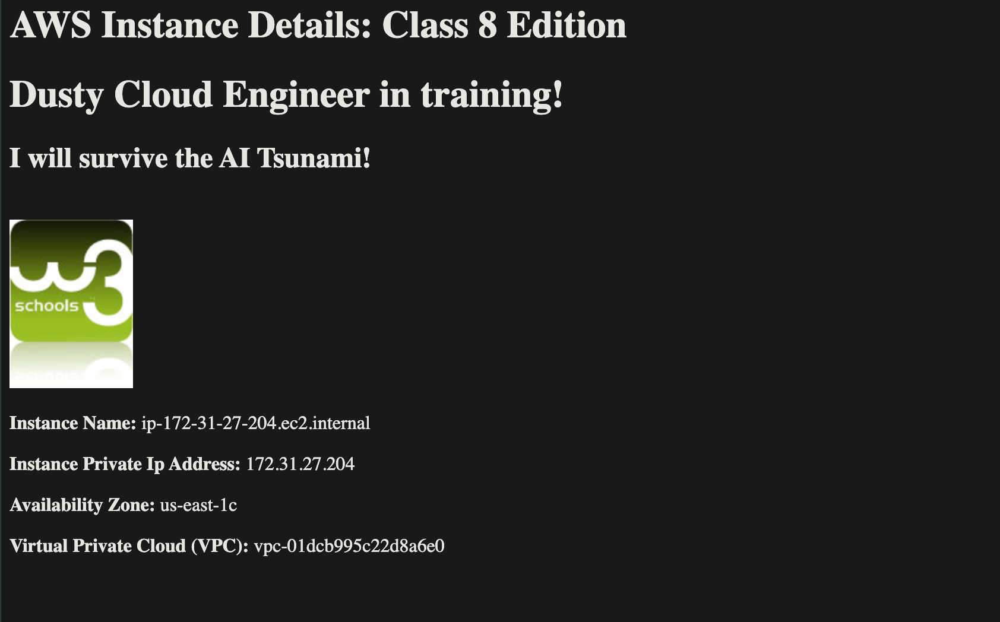
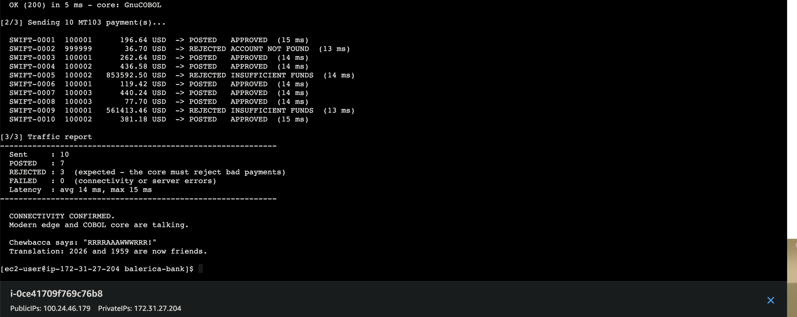
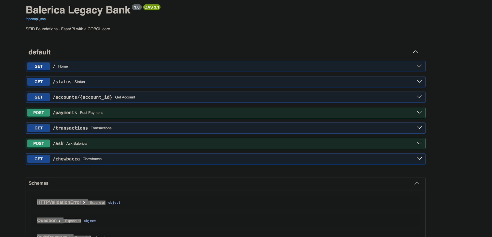
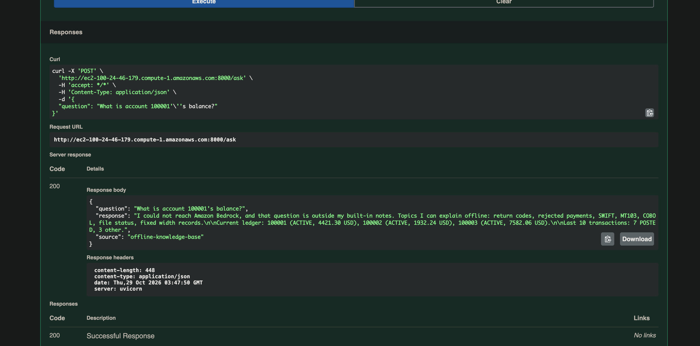

### Deploy 3
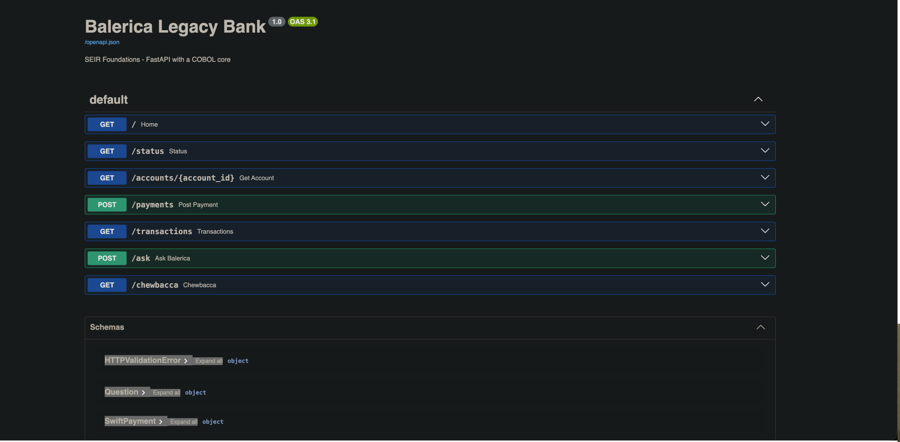
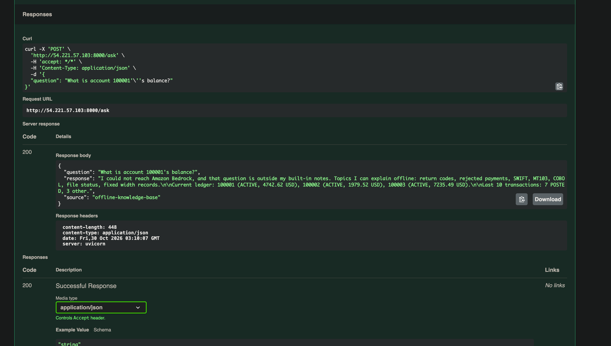

### Deploy 4
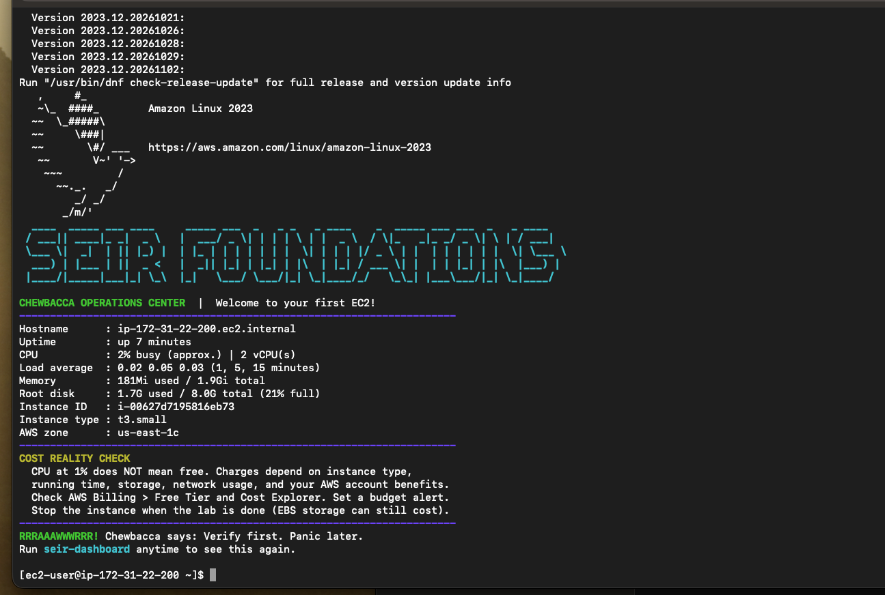
SWIFT report: [rep4-swift-report.txt](screenshots/rep4/rep4-swift-report.txt) (Sent 10 · POSTED 7 · REJECTED 3 · **FAILED 0**)
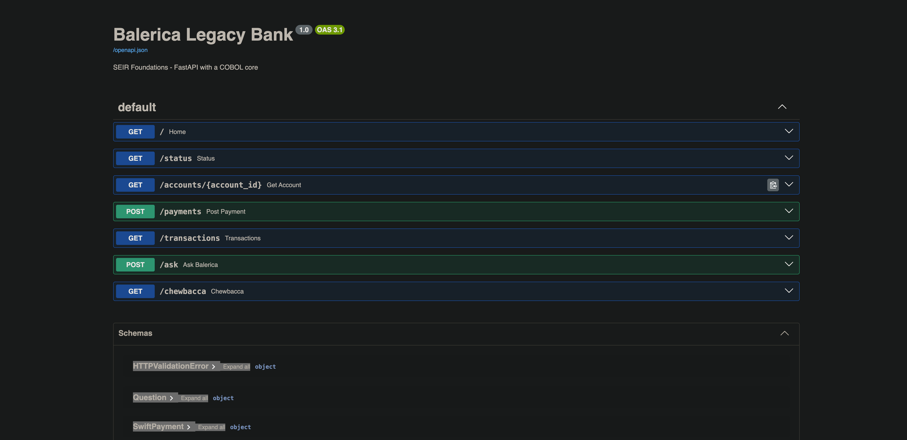
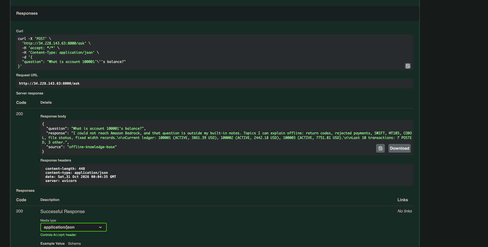
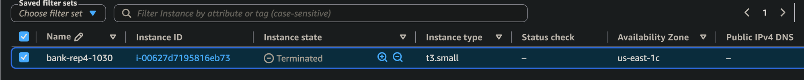

### Deploy 5
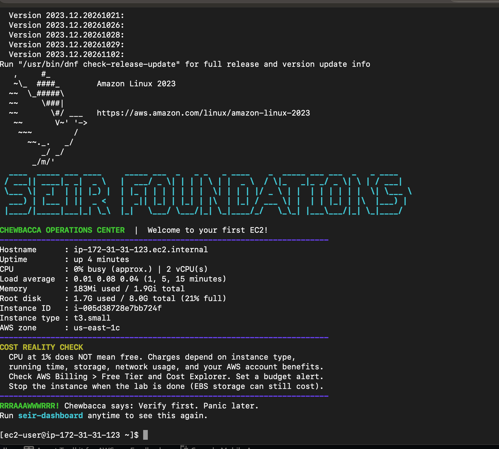
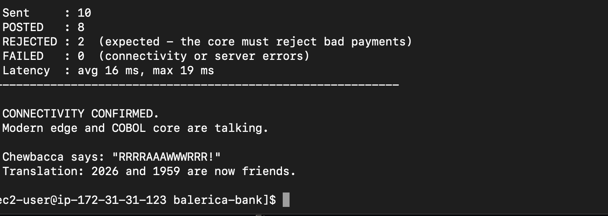
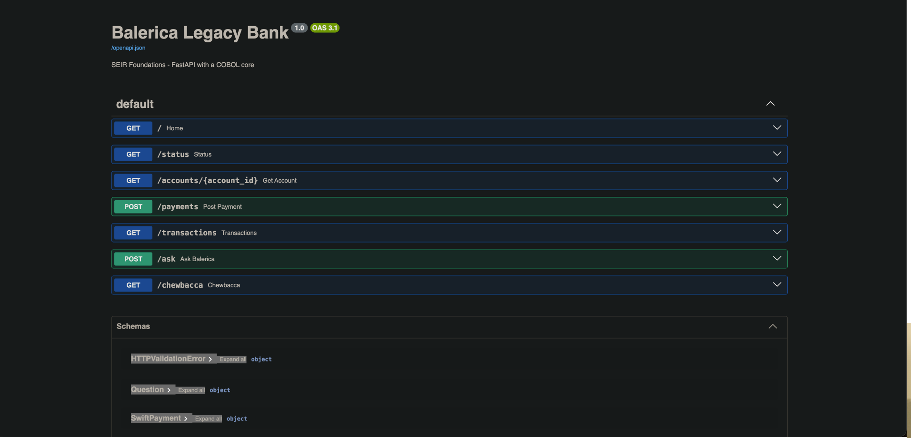
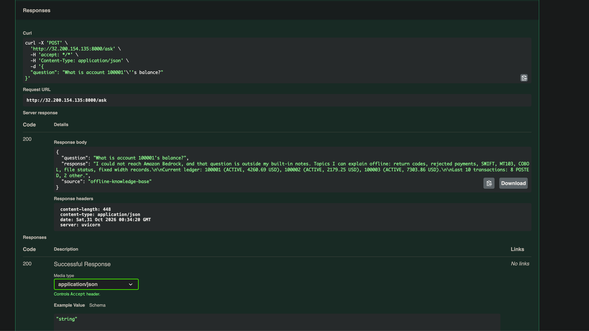
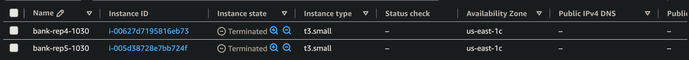

Deploy 3 also produced my Lab 0.5 extra credit: see [`../lab0.5_basics_contd/`](../lab0.5_basics_contd/).

## Why `/ask` says `offline-knowledge-base`

Amazon Bedrock needs an IAM role on the instance (instructor-created), `AWS_REGION` set to where model access is enabled, and a real `BEDROCK_MODEL_ID`. Without the role, `/ask` still answers with Code 200 from its built-in notes. That's expected for now.

## My notes

- I've learned that if you just listen to Theo and do exactly what he tells us to do, we will be fine. I do get it though: one thing wrong and it won't work.